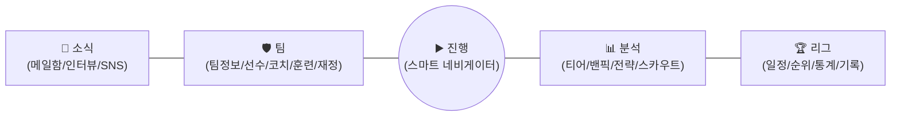

# 🏆 리그 매니지먼트: 챔피언스 (League Management: Champions) — 마스터 기획서 (Master GDD)

---

> [!TIP]
> **마스터 기획서 목차 뷰어 (Interactive Outline):** 본 문서는 모든 세부 항목이 접혀 있는 목차식 인터랙티브 뷰어로 구성되어 있습니다. 원하는 섹션의 토글(▶)을 클릭하여 세부 명세와 데이터 테이블을 확인하실 수 있습니다.

## 📑 전체 목차 요약 (Quick Jump)
1. **[1. 게임 개요 및 핵심 설계 철학](#1-게임-개요-및-핵심-설계-철학)** — 1.1 기본 정보 / 1.2 3대 핵심 개발 철학
2. **[2. UI 구조 및 시즌/주간 진행 루프](#2-ui-구조-및-시즌주간-진행-루프)** — 2.1 하단 5탭 네비게이션 / 2.2 프리시즌 10단계 프로세스
3. **[3. 인게임 ‘챔피언스’ 규칙 및 경기 엔진](#3-인게임-챔피언스champions-규칙-및-경기-엔진)** — 3.1 경기 구성 / 3.2 맵·건물·오브젝트 / 3.3 시야·전술카드
4. **[4. 밴픽 평가, 챔피언 및 아이템 시스템](#4-밴픽-평가-챔피언80종-및-아이템21종-시스템)** — 4.1 포지션 분류 / 4.2 밴픽 지표 / 4.3 아이템 21종 / 4.4 챔피언 80종
5. **[5. 선수 / 코치 / 감독 데이터 및 육성 시스템](#5-선수--코치--감독-데이터-및-육성-시스템)** — 5.1 선수DB / 5.2 선수특성50선·상태10선 / 5.3 코치DB·특성30선 / 5.4 감독시스템
6. **[6. 리그 시스템, 디비전 승강제 및 연간 스케줄](#6-리그-시스템-디비전-승강제-및-연간-스케줄)** — 6.1 5대리그·4디비전(150팀) / 6.2 48주 스케줄
7. **[7. 구단 재정, 스폰서십 및 시설 시스템](#7-구단-재정-스폰서십20종-및-시설-시스템)** — 7.1 수입·지출 / 7.2 4대 핵심시설 / 7.3 스폰서십 20종

---


## 1. 게임 개요 및 핵심 설계 철학


<details>
<summary><b style="font-size: 1.1em; cursor: pointer;">📂 1.1 기본 정보 (클릭하여 내용 펼치기)</b></summary>

* **게임 타이틀:** 리그 매니지먼트: 챔피언스 (*League Management: Champions*)
* **장르:** MOBA e스포츠 구단 매니지먼트 & 전술 시뮬레이션
* **플랫폼 / 뷰포트:** 웹(Next.js) 및 모바일 최적화 **세로형(Vertical) UI**
* **핵심 목표:** 플레이어는 가상 MOBA 게임 **‘챔피언스(Champions)’** 프로 리그의 구단주 겸 감독이 되어, 항상 최하위 디비전인 **리그 D(4부 리그)**에서 출발해 선수 영입·육성, 재정·시설 경영, 밴픽 및 인게임 전술 지휘를 거쳐 **리그 A(1부 리그) 우승과 국제대회 제패**를 달성한다.


</details>

<details>
<summary><b style="font-size: 1.1em; cursor: pointer;">📂 1.2 3대 핵심 개발 철학 (클릭하여 내용 펼치기)</b></summary>

1. **선택지 중심의 피로도 최소화 (Low-Fatigue UX)**
   * 복잡한 숫자 계산이나 미세 조작 대신 **4~5지선다 선택지**(예: 연봉/이적료 5단계 제안, 인게임 30초 4지선다 전술 카드, 인터뷰 4지선다 답변)로 모든 핵심 의사결정을 수행한다.
   * 반복 작업(주간 개인 훈련 배정, 패치 후 챔피언 티어 정리, 밴픽 추천 등)은 **코칭스태프에게 위임(자동화)**할 수 있으며, 하단 중앙의 **`[진행]` 버튼**이 다음 일정 진행 전 반드시 처리해야 할 탭으로 플레이어를 자동 안내한다.
2. **산술 연산 기반 결과 도출 + 시나리오 스크립트 재생 (Deterministic Engine)**
   * 무거운 실시간 물리 충돌 연산이나 복잡한 AI 의사결정 트리 없이, **매 30초(인게임 약 2분)마다 선수 스탯·특성·컨디션, 챔피언/아이템 레벨별 전투력, 조합 상성을 산술 연산**하여 교전 및 운영 결과를 즉시 도출한다.
   * 도출된 결과값에 가장 부합하는 **사전 제작 동선 스크립트(좌표 이동 애니메이션)**를 미니맵 바둑알 뷰(4배속)와 도트 하이라이트 뷰(1배속)로 재생하여 가벼운 성능과 높은 연출 몰입감을 동시에 달성한다.
3. **고정 시드 + 회차별 난수 변주 (Semi-Randomized Replayability)**
   * 실제 프로게이머는 등장하지 않으나, 다회차 플레이 시 특정 가상 선수에게 애착을 가질 수 있도록 **선수·코치·구단별 고유 특징(기본 스탯 경향, 모스트픽, 초기 자금 등)을 하드코딩**해 둔다.
   * 단, 새 게임을 시작할 때마다 **일정 범위의 난수 보정**을 거쳐 선수들의 성장기대치·초기 능력치와 구단 전력이 조금씩 달라지며, 이에 따라 150개 팀이 **리그 A~D에 동적으로 재배치**된다. (플레이어가 선택한 구단은 전력·자금 규모와 무관하게 무조건 **리그 D**에서 시작하여 난이도 조절 역할을 겸한다.)

</details>

---

## 2. UI 구조 및 시즌/주간 진행 루프


<details>
<summary><b style="font-size: 1.1em; cursor: pointer;">📂 2.1 세로형 하단 5탭 네비게이션 (클릭하여 내용 펼치기)</b></summary>


* **소식 탭:** 패치 노트(메일함), 이적 오퍼 수신, 미디어 데이 및 경기 전후 인터뷰, 팬덤 SNS 여론 확인.
* **팀 탭:** 구단 개요, 선수단(7~10명) 관리, 코치진(3~5명) 보직 배치, 주간 훈련 설정(자동 위임 지원), 재정/스폰서/시설 업그레이드.
* **진행 버튼 (중앙):** 다음 요일/일정으로 넘어가기 위해 완료해야 하는 필수 업무가 남아있을 경우 해당 탭 화면으로 즉시 이동시키며, 모든 필수 업무 완료 시 시간을 진행시킨다.
* **분석 탭:** 패치 메타 분석 및 팀 주관적 챔피언 티어표(S~D) 설정, 밴픽 시뮬레이션, 사전 전략 설정, 타 팀 선수 스카우트(안개 제거).
* **리그 탭:** 주간 경기 일정, 디비전별 순위표, 선수/챔피언 통계, 역대 우승 및 어워드 기록(명예의 전당).


</details>

<details>
<summary><b style="font-size: 1.1em; cursor: pointer;">📂 2.2 프리시즌 10단계 프로세스 (12월 스토브리그 ~ 1월 개막 직전) (클릭하여 내용 펼치기)</b></summary>

1. **감독 프로필 & 구단 선택:** 감독 이름, 초상화(10종), 운영 성향 3종, 사용 언어(2개) 설정 후 시작 구단 선택(리그 D 배정).
2. **구단 비전 및 목표 협상:** 보드진과 시즌 기본 예산 및 목표 순위 합의.
3. **전술/라인업 세팅 & 1차 스크림:** 현재 보유 로스터로 첫 연습 경기 진행 및 전력 점검(감독 개입 없이 결과 데이터만 산출).
4. **스폰서 계약:** 스크림 결과와 구단 위상을 바탕으로 **시즌 메인 스폰서 1곳** 선택 및 지원금 확보.
5. **선수단 면담 및 기존 재계약:** 라커룸 의욕(`Morale`) 관리 및 계약 만료 임박 선수 재계약 협상.
6. **프리시즌 이적 시장 & 훈련:** 무소속(FA) 신입/기존 선수 영입, 타 팀 선수 바이아웃 영입, 선수 매각/맞트레이드, 코치 영입, 챔피언 폭 단련.
7. **2차 스크림:** 신규 영입생과의 팀워크 및 전술 완성도 최종 점검.
8. **시즌 로스터 최종 제출 & 패치/상대 분석:** 로스터(최소 7명) 확정 및 개막전 패치 노트/상대 전력 분석.
9. **개막전 기자회견 / 미디어 데이:** 시즌 출사표, 라이벌 도발, 스폰서 언급 등 4지선다 인터뷰 진행.
10. **정규 리그 1주 차 개막!**

</details>

---

## 3. 인게임 ‘챔피언스(Champions)’ 규칙 및 경기 엔진


<details>
<summary><b style="font-size: 1.1em; cursor: pointer;">📂 3.1 경기 시간 및 1세트 진행 구성 (클릭하여 내용 펼치기)</b></summary>

* **다전제 및 드래프트 방식:**
  * 기본 **Bo3(3판 2선승제)** 중심, 주요 경기(리그 플레이오프 준결승·결승, 국제대회 상위 라운드 및 탈락전)는 **Bo5(5판 3선승제)**.
  * **하드 피어리스 드래프트(Hard Fearless Draft)** 적용 (이전 세트에서 양 팀이 픽했던 모든 챔피언은 이후 세트에서 선택 불가 / 총 80종 챔피언 풀 기준).
* **1세트 플레이 타임 구성 (실제 시간 약 7분 ~ 8분 30초 / 인게임 약 24분 ~ 28분):**
  * **4배속 미니맵 바둑알 관전 & 30초마다 4지선다 전술 선택:** `30초 × 12~15회 = 약 6분 ~ 7.5분` (실제 시간 30초 = 인게임 약 2분 진행).
  * **핵심 1배속 도트 하이라이트 연출:** `10~12초 × 4~5회 = 약 1분` (주요 한타·솔로킬·오브젝트 스틸 장면을 도트 캐릭터와 스킬 이펙트로 재생. ※ *1차 프로토타입에서는 제외하고 4배속 바둑알 미니맵 뷰만 우선 구현*).
  * **경기 종료 판정:** 턴 횟수가 정해져 있는 것이 아니라, 인게임 연산 결과 한쪽 진영의 **1차 포탑 → 2차 포탑 → 넥서스(최종 타워)**가 파괴되는 시점에 경기가 즉시 종료되며, 그 결과 평균적으로 12~15회 선택 내외에서 승패가 갈린다.


</details>

<details>
<summary><b style="font-size: 1.1em; cursor: pointer;">📂 3.2 전장(맵), 건물 및 오브젝트 규칙 (클릭하여 내용 펼치기)</b></summary>

* **진영 (Side):**
  * **블루 진영 (좌하단):** 밴픽 우선권(1픽 권한) 보유.
  * **레드 진영 (우상단):** 마지막 카운터 픽(10픽 권한) 보유.
* **건물 (Structures):**
  * **타워 (Tower):** 탑·미드·바텀 각 레인별로 **2개씩(1차 포탑, 2차 포탑)** 존재.
  * **넥서스 (Nexus):** 쌍둥이 포탑 없이 단독으로 기지를 수비하는 **최종 타워**. 강력한 단일/광역 공격력을 가지며, 파괴 시 즉시 승리.
* **미니언 (Minions):** 0초 최초 생성 후 **1분마다** 각 레인에 근접 3마리 + 원거리 3마리(총 6마리) 생성. 처치 시 골드와 경험치 제공.
* **소형 오브젝트 (정글 에어리어 4종):** 기본적으로 정글러가 사냥하나, 라인별로 인접해 있어 라이너의 더티파밍도 가능. 정글러의 역할군에 따라 사냥 속도가 달라 동선과 갱킹 루트가 결정된다.

| 소형 오브젝트 | 출현 위치 | 구성 개체 및 특징 | 사냥 유리 역할군 |
| :--- | :--- | :--- | :--- |
| **울프 (Wolf)** | 탑 레인 인접 정글 | 대형 1 + 소형 2 / 낮은 체력, **매우 높은 공격력**, 빠른 이속 | **탱커** (높은 방어력으로 피해 무시) |
| **레이스 (Wraith)** | 미드 위쪽 인접 정글 | 대형 1 단독 / 높은 체력, 높은 공격력, **디버프에 매우 취약** | **디버퍼** (상성 저격으로 고속 사냥) |
| **슬라임 (Slime)** | 미드 아래쪽 인접 정글 | 대형 1 + 소형 4 (총 5마리) / 적당한 체력·공격력, **다수 개체** | **마법딜러** (광역 스킬로 순식간에 정리) |
| **골렘 (Golem)** | 바텀 레인 인접 정글 | 대형 1 단독 / 높은 체력, **매우 느린 이동속도** | **물리딜러** (원거리 카이팅으로 일방 타격) |

* **대형 오브젝트 (리버 에어리어 2대 둥지):**

| 대형 오브젝트 | 출현 위치 | 최초 출현 / 재생성 주기 | 처치 시 핵심 버프 효과 |
| :--- | :--- | :--- | :--- |
| **피닉스** | 바텀 쪽 강가 둥지 | **4분** 출현 / **4분마다** 재생성 | 아군 전원 **체력·공격력·마법력·이동속도 영구 증가 (스택형)** |
| **거대 피닉스** | 바텀 쪽 강가 둥지 | **24분**에 피닉스가 최종 진화 | 아군 전원 **초강력 결전 전투 버프** (단 한 번의 한타로 게임 종결 가능) |
| **크라켄** | 탑 쪽 강가 둥지 | **7분** 출현 (단 1회) | 몇 분간 보유자 주변 **아군 미니언 체력·공속·이속 폭발적 증가** (초중반 포탑 철거) |
| **거대 크라켄** | 탑 쪽 강가 둥지 | **14분** 출현 / **5분마다** 재생성 | 크라켄보다 훨씬 강력한 **고속 공성 미니언 강화 효과** (중후반 승부처) |

* **챔피언 레벨 (1 ~ 10레벨):**
  * **Lv 1:** A스킬 해금, 체력 증가 / **Lv 2:** B스킬 해금, 체력 증가 / **Lv 3:** 이동속도 증가, 체력 증가 / **Lv 4:** **C스킬(궁극기) 해금**, 체력 증가
  * **Lv 5 ~ 7:** A → B → C스킬 쿨타임 감소 및 체력 증가 / **Lv 8 ~ 10:** A → B → C스킬 쿨타임 추가 감소 및 체력 증가.


</details>

<details>
<summary><b style="font-size: 1.1em; cursor: pointer;">📂 3.3 전장의 안개(Fog of War)와 30초 전술 카드 연산 (클릭하여 내용 펼치기)</b></summary>

* **시야확보와 전장의 안개:** 미니맵은 아군과 와드 시야가 있는 곳만 밝힌다. `시야확보` 스탯이 붙은 아이템을 든 챔피언(주로 서포터)이 돌아다니며 제거 불가능한 단기 지속 와드를 자동 설치한다. 시야가 넓을수록 플레이어는 적 정글러 위치나 오브젝트 동향을 파악해 30초 전술 카드를 정확히 고를 수 있다.
* **30초 4지선다 전술 카드:**
  * 인게임 시간대, 조합, 선수 성향, 오브젝트 상황에 맞춰 4개의 전술 카드가 제시된다.
  * 카드의 성격(교전/공격형, 운영/스플릿형, 매복/변칙형, 수비/성장형 등)에 따라 **등장 순서는 일관되게 정렬**하되, 상황에 따라 같은 카테고리의 카드가 복수(예: 피닉스 버스트 / 크라켄 버스트, 또는 탑 스플릿 / 미드 스플릿)로 등장할 수 있다.
* **상대 AI 감독 선택 및 결과 연산:**
  * 상대 AI 감독의 카드 선택은 화면에 노출하지 않고, 현재 상황에서 기대 결과값 가중치가 높은 순으로 내림차순 정렬한 뒤 상대 감독/팀 역량에 따라 상위 선택지를 고르는 알고리즘으로 처리한다.
  * 챔피언 전투력은 단순 레벨 비례 공식이 아니라 **챔피언별 [챔피언 레벨(1~10) × 아이템 등급(1~10)] 고유 전투력 테이블**을 참조하여 챔피언마다 다른 전성기 타이밍을 반영한다.
  * **1:1 라인전 연산:** `선수 스탯(피지컬/판단력/결정력)` + `포지션 적합성` + `챔피언 숙련도(모스트픽)` + `챔피언 객관적 성능(0~100)` + `80×80 챔피언 1:1 상성 상수`
  * **5:5 팀파이트 연산:** 위 요소 + `선수 팀워크/정신력` + `전투역할군 밸런스` + `전투방식 가위바위보 상성(정석>돌진>견제)` + `파워커브 시기별 보정` + `전술 카드 상성`

</details>

---

## 4. 밴픽 평가, 챔피언(80종) 및 아이템(21종) 시스템


<details>
<summary><b style="font-size: 1.1em; cursor: pointer;">📂 4.1 포지션 고유 버프 및 챔피언 분류 체계 (클릭하여 내용 펼치기)</b></summary>

* **5대 포지션 및 라인 고유 버프:**
  * **탑레이너 (TOP):** 초중반 미니언 처치 시 **경험치 증가**.
  * **정글러 (JGL):** 오브젝트 처치 시 **추가 골드·경험치 획득** 및 **레벨당 오브젝트 처형 데미지**.
  * **미드레이너 (MID):** 레벨당 **이동속도 및 스킬 데미지 증가**.
  * **바텀레이너 (BOT):** 초중반 미니언 처치 시 **골드 증가**.
  * **서포터 (SUP):** 어시스트 기록 시 **추가 골드 및 경험치 획득**.
* **전투역할군 (5종):** `탱커`, `물리딜러`, `마법딜러`, `버퍼`, `디버퍼` (주역할군 가중치 1.0 + 부역할군 0.5 / 단일 역할군은 1.5).
* **전투사거리 (3종):** `근거리`, `원거리`, `유동적사거리`.
* **전투범위 (3종):** `소규모`(단일 대상 위주), `대규모`(광역 대상 위주), `유동적범위`.
* **전투방식 (4종 - 가위바위보 상성):**
  * **정석방식** (돌진에 강함 / 견제에 약함) ➡️ **돌진방식** (견제에 강함 / 정석에 약함) ➡️ **견제방식** (정석에 강함 / 돌진에 약함) ➡️ **정석방식**
  * 팀 내 단일 방식이 50% 이상이면 해당 방식으로 확정되며, 미만일 경우 **유동적방식**(상성 유불리 0)으로 판정.
* **파워커브 (5종 - 초반 / 중반 / 후반 가중치):**
  * `초반강력` (3.5 / 3.5 / 1.5) | `중반강력` (1.5 / 4.5 / 2.5) | `후반강력` (1.5 / 2.5 / 4.5) | `중반정체` (3.5 / 1.5 / 3.5) | `안전지속` (2.5 / 2.5 / 3.5)


</details>

<details>
<summary><b style="font-size: 1.1em; cursor: pointer;">📂 4.2 밴픽 5대 평가 지표 (클릭하여 내용 펼치기)</b></summary>

1. **전투역할군 조합 밸런스:** 물리/마법/탱커는 각 `20%~40%`, 버퍼/디버퍼는 각 `5%~20%`일 때 정상. 기준 이탈 시 페널티(올AD, 노탱 등 방지).
2. **전투방식 상성:** 양 팀의 확정된 대표 전투방식 간 가위바위보 상성 우열 판정.
3. **포지션 적합성:** 해당 라인 포지션 태그가 없는 챔피언 기용 시 강력한 라인전/연산 페널티 부여.
4. **모스트픽 숙련도:** 선수의 숙련도 상위 3개 챔피언(모스트픽) 장착 시 보너스 부여.
5. **챔피언 티어(메타 파워):** 패치마다 변하는 챔피언의 숨겨진 객관적 성능(0~100).
   * 플레이어 팀은 `분석 -> 티어` 탭에서 주관적 티어(S~D)를 직접 조정하거나 코치(`분석력` 비례 정확도)에게 위임한다.
   * 상대 AI 팀(149개 팀)은 별도의 주관적 티어표를 저장하지 않고, 객관적 성능(0~100) 정렬 리스트에서 해당 팀 코치의 `밴픽력/분석력` 수준에 따른 오차 범위 내의 챔피언을 선택한다.


</details>

<details>
<summary><b style="font-size: 1.1em; cursor: pointer;">📂 4.3 단일 성장형 아이템 21종 ($\binom{7}{2}$ 조합 체계) (클릭하여 내용 펼치기)</b></summary>

* 모든 챔피언은 경기 시작 전 **단 하나의 아이템(1등급)**을 선택해 시작하며, 귀환 시 보유 골드가 임계치를 넘으면 자동으로 최대 **10등급**까지 업그레이드된다.
* **7대 아이템 스탯:** `물리방어막`, `마법방어막`, `공격력`, `공격속도`, `마법력`, `스킬가속`, `시야확보`.
* **직관적 3색 체력바 UX:** 복잡한 방어력/마법저항력 공식 대신 데미지를 체력보다 먼저 흡수하는 전용 방어막 개념을 도입해 **초록색(체력) + 빨간색(물리방어막) + 파란색(마법방어막)**으로 표시한다.

| 아이템 명칭 | 상승 스탯 조합 (2종) | 추천 역할군 / 포지션 |
| :--- | :--- | :--- |
| **불멸의수호갑** | 물리방어막 + 마법방어막 | 정통 탱커 |
| **숭고한희생** | 물리방어막 + 스킬가속 | 유틸리티형 탱커 |
| **비전파쇄망토** | 마법방어막 + 스킬가속 | 유틸리티형 탱커 |
| **광폭연사포** | 공격력 + 공격속도 | 정통 물리형 원거리딜러 |
| **새벽의비수** | 공격력 + 스킬가속 | 물리형 암살자 / 물리형 브루저 |
| **강철의돌격검** | 공격력 + 물리방어막 | 물리형 브루저 |
| **심연건틀릿** | 공격력 + 마법방어막 | 물리형 브루저 |
| **파멸의사슬톱** | 공격속도 + 물리방어막 | 딜탱 물리형 원거리딜러 / 물리형 브루저 |
| **별무리유성궁** | 공격속도 + 마법방어막 | 딜탱 물리형 원거리딜러 / 물리형 브루저 |
| **천상폭풍성서** | 마법력 + 스킬가속 | 정통 마법형 메이지 |
| **대악마의화살** | 마법력 + 공격속도 | 마법형 원거리딜러 / 마법형 평타 브루저 |
| **마수의비늘** | 마법력 + 물리방어막 | 마법형 브루저 / 인파이팅 메이지 |
| **공허흡수구체** | 마법력 + 마법방어막 | 마법형 브루저 / 인파이팅 메이지 |
| **차원이동기** | 공격속도 + 스킬가속 | 유틸리티형 원거리딜러 |
| **저주가시검** | 공격력 + 마법력 | 하이브리드형 원거리딜러 / 메이지 |
| **성령의기도문** | 시야확보 + 마법력 | 마법형 서포터 |
| **황혼파수꾼낫** | 시야확보 + 공격력 | 물리형 서포터 |
| **철벽의이정표** | 시야확보 + 물리방어막 | 탱커형 서포터 |
| **심해의등불** | 시야확보 + 마법방어막 | 탱커형 서포터 |
| **여명의정찰탄** | 시야확보 + 공격속도 | 원거리딜러형 서포터 |
| **전령의부적** | 시야확보 + 스킬가속 | 유틸리티형 서포터 |


</details>

<details>
<summary><b style="font-size: 1.1em; cursor: pointer;">📂 4.4 챔피언 80종 마스터 목록 및 배분 체계 (클릭하여 내용 펼치기)</b></summary>

> [!TIP]
> **하드 피어리스 Bo5 대비 80종 배분 완성:** 초기 60종의 탑 치우침을 해소하기 위해 바텀(+9종), 정글(+5종), 서포터(+4종), 미드(+2종)를 확장하여 포지션별 밸런스를 달성하였으며, 80종 모두 고유한 역할군·사거리·범위·전투방식·파워커브 조합을 갖추어 상호 중복이 없습니다. 특히 신규 20종은 `유동적범위`와 `유동적방식`을 배제하고 명확한 전술적 특성(`소규모`/`대규모`, `정석`/`돌진`/`견제`)을 부여했습니다.

<details>
<summary><b>📋 확정된 챔피언 80종 전체 데이터 (클릭하여 펼치기)</b></summary>

| 번호 | 한글명 | 영문 ID | 주역할군 | 부역할군 | 사거리 | 범위 | 전투방식 | 파워커브 | 가능 포지션 |
| :---: | :--- | :--- | :--- | :--- | :--- | :--- | :--- | :--- | :--- |
| 001 | 보우마스터 | BowMaster | 물리딜러 | - | 원거리 | 소규모 | 정석방식 | 안전지속 | 바텀레이너, 탑레이너 |
| 002 | 레이저슈터 | LaserShooter | 물리딜러 | - | 원거리 | 유동적범위 | 견제방식 | 후반강력 | 미드레이너, 바텀레이너 |
| 003 | 스나이퍼 | Sniper | 물리딜러 | - | 원거리 | 소규모 | 견제방식 | 후반강력 | 바텀레이너, 탑레이너 |
| 004 | 에이전트 | Agent | 물리딜러 | - | 유동적사거리 | 소규모 | 돌진방식 | 중반정체 | 미드레이너, 바텀레이너, 정글러, 탑레이너 |
| 005 | 샷건블래스터 | ShotgunBlaster | 물리딜러 | - | 유동적사거리 | 대규모 | 정석방식 | 중반강력 | 바텀레이너, 탑레이너 |
| 006 | 닌자 | Ninja | 물리딜러 | - | 원거리 | 소규모 | 돌진방식 | 중반정체 | 미드레이너, 바텀레이너 |
| 007 | 저글러 | Juggler | 물리딜러 | - | 원거리 | 대규모 | 견제방식 | 안전지속 | 바텀레이너, 탑레이너 |
| 008 | 폴리스 | Police | 물리딜러 | - | 원거리 | 소규모 | 정석방식 | 초반강력 | 바텀레이너, 정글러, 탑레이너 |
| 009 | 머스킷티어 | Musketeer | 물리딜러 | - | 원거리 | 대규모 | 정석방식 | 안전지속 | 바텀레이너, 탑레이너 |
| 010 | 헤비봄버 | HeavyBomber | 물리딜러 | - | 원거리 | 대규모 | 견제방식 | 후반강력 | 미드레이너, 바텀레이너, 탑레이너 |
| 011 | 부메랑마스터 | BoomerangMaster | 물리딜러 | - | 유동적사거리 | 유동적범위 | 견제방식 | 안전지속 | 미드레이너, 바텀레이너, 탑레이너 |
| 012 | 캐논슈터 | CannonShooter | 물리딜러 | - | 원거리 | 대규모 | 정석방식 | 후반강력 | 바텀레이너, 탑레이너 |
| 013 | 버서커 | Berserker | 물리딜러 | 탱커 | 근거리 | 유동적범위 | 돌진방식 | 중반강력 | 정글러, 탑레이너 |
| 014 | 복서 | Boxer | 물리딜러 | 탱커 | 근거리 | 소규모 | 돌진방식 | 초반강력 | 서포터, 정글러, 탑레이너 |
| 015 | 펜싱마스터 | FencingMaster | 물리딜러 | 탱커 | 근거리 | 소규모 | 유동적방식 | 후반강력 | 미드레이너, 정글러, 탑레이너 |
| 016 | 롱스피어 | LongSpear | 물리딜러 | 탱커 | 유동적사거리 | 유동적범위 | 견제방식 | 안전지속 | 정글러, 탑레이너 |
| 017 | 헤비메이스 | HeavyMace | 물리딜러 | 탱커 | 근거리 | 대규모 | 돌진방식 | 중반정체 | 서포터, 정글러, 탑레이너 |
| 018 | 그레이트소드 | GreatSword | 물리딜러 | 탱커 | 근거리 | 대규모 | 정석방식 | 중반강력 | 정글러, 탑레이너 |
| 019 | 어쌔신 | Assassin | 물리딜러 | - | 근거리 | 소규모 | 돌진방식 | 초반강력 | 미드레이너, 바텀레이너, 정글러 |
| 020 | 블레이드윙 | BladeWing | 물리딜러 | - | 근거리 | 소규모 | 돌진방식 | 중반강력 | 미드레이너, 바텀레이너, 정글러, 탑레이너 |
| 021 | 그림리퍼 | GrimReaper | 물리딜러 | - | 근거리 | 유동적범위 | 정석방식 | 후반강력 | 미드레이너, 정글러, 탑레이너 |
| 022 | 팬텀시프 | PhantomThief | 물리딜러 | - | 근거리 | 소규모 | 유동적방식 | 중반정체 | 미드레이너, 바텀레이너, 정글러 |
| 023 | 플래그베어러 | FlagBearer | 물리딜러 | 버퍼 | 근거리 | 대규모 | 돌진방식 | 중반강력 | 서포터, 정글러, 탑레이너 |
| 024 | 워드러머 | WarDrummer | 물리딜러 | 버퍼 | 유동적사거리 | 대규모 | 정석방식 | 안전지속 | 서포터, 탑레이너 |
| 025 | 체인헌터 | ChainHunter | 물리딜러 | 디버퍼 | 유동적사거리 | 소규모 | 견제방식 | 중반정체 | 미드레이너, 바텀레이너, 서포터, 정글러 |
| 026 | 해머브레이커 | HammerBreaker | 물리딜러 | 디버퍼 | 근거리 | 대규모 | 돌진방식 | 안전지속 | 서포터, 정글러, 탑레이너 |
| 027 | 플레임위치 | FlameWitch | 마법딜러 | - | 원거리 | 대규모 | 정석방식 | 중반강력 | 미드레이너, 바텀레이너 |
| 028 | 메카위자드 | MechaWizard | 마법딜러 | - | 유동적사거리 | 소규모 | 견제방식 | 후반강력 | 미드레이너, 바텀레이너 |
| 029 | 포이즌메이지 | PoisonMage | 마법딜러 | - | 원거리 | 유동적범위 | 견제방식 | 안전지속 | 미드레이너, 서포터, 탑레이너 |
| 030 | 스타게이저 | StarGazer | 마법딜러 | - | 원거리 | 대규모 | 견제방식 | 후반강력 | 미드레이너, 바텀레이너, 서포터, 탑레이너 |
| 031 | 룬블레이더 | RuneBlader | 마법딜러 | 탱커 | 유동적사거리 | 유동적범위 | 돌진방식 | 후반강력 | 미드레이너, 탑레이너 |
| 032 | 미스틱댄서 | MysticDancer | 마법딜러 | 탱커 | 근거리 | 유동적범위 | 유동적방식 | 중반정체 | 미드레이너, 정글러, 탑레이너 |
| 033 | 지오맨서 | Geomancer | 마법딜러 | 탱커 | 근거리 | 대규모 | 정석방식 | 중반강력 | 미드레이너, 서포터, 탑레이너 |
| 034 | 웨이브서퍼 | WaveSurfer | 마법딜러 | 탱커 | 유동적사거리 | 대규모 | 돌진방식 | 초반강력 | 미드레이너, 정글러, 탑레이너 |
| 035 | 엑소시스트 | Exorcist | 마법딜러 | - | 근거리 | 소규모 | 돌진방식 | 초반강력 | 미드레이너, 정글러 |
| 036 | 키네시스 | Kinesis | 마법딜러 | - | 유동적사거리 | 유동적범위 | 유동적방식 | 중반강력 | 미드레이너, 바텀레이너, 탑레이너 |
| 037 | 볼트러너 | VoltRunner | 마법딜러 | - | 근거리 | 소규모 | 돌진방식 | 중반정체 | 미드레이너, 탑레이너 |
| 038 | 네크로맨서 | Necromancer | 마법딜러 | - | 유동적사거리 | 소규모 | 정석방식 | 초반강력 | 미드레이너, 서포터, 탑레이너 |
| 039 | 루미너스 | Luminous | 마법딜러 | 버퍼 | 원거리 | 소규모 | 정석방식 | 후반강력 | 미드레이너, 바텀레이너, 서포터 |
| 040 | 드루이드 | Druid | 마법딜러 | 버퍼 | 유동적사거리 | 대규모 | 정석방식 | 안전지속 | 서포터, 정글러, 탑레이너 |
| 041 | 윈드메이커 | WindMaker | 마법딜러 | 버퍼 | 원거리 | 대규모 | 견제방식 | 중반강력 | 미드레이너, 서포터 |
| 042 | 바드 | Bard | 마법딜러 | 버퍼 | 원거리 | 대규모 | 유동적방식 | 중반정체 | 바텀레이너, 서포터 |
| 043 | 프로스트위치 | FrostWitch | 마법딜러 | 디버퍼 | 원거리 | 대규모 | 견제방식 | 중반정체 | 미드레이너, 서포터, 탑레이너 |
| 044 | 크로노스 | Chronos | 마법딜러 | 디버퍼 | 원거리 | 유동적범위 | 정석방식 | 중반강력 | 미드레이너, 서포터, 탑레이너 |
| 045 | 페어리 | Fairy | 마법딜러 | 디버퍼 | 원거리 | 소규모 | 견제방식 | 초반강력 | 미드레이너, 서포터 |
| 046 | 나이트메어 | Nightmare | 마법딜러 | 디버퍼 | 유동적사거리 | 대규모 | 돌진방식 | 후반강력 | 미드레이너, 서포터, 정글러 |
| 047 | 아이언실드 | IronShield | 탱커 | - | 근거리 | 소규모 | 돌진방식 | 중반강력 | 서포터, 탑레이너 |
| 048 | 좀비워리어 | ZombieWarrior | 탱커 | - | 근거리 | 대규모 | 정석방식 | 안전지속 | 서포터, 탑레이너 |
| 049 | 라이온하트 | LionHeart | 탱커 | 물리딜러 | 근거리 | 유동적범위 | 돌진방식 | 안전지속 | 정글러, 탑레이너 |
| 050 | 자이언트비틀 | GiantBeetle | 탱커 | 물리딜러 | 근거리 | 소규모 | 정석방식 | 초반강력 | 서포터, 정글러, 탑레이너 |
| 051 | 카발리어 | Cavalier | 탱커 | 물리딜러 | 유동적사거리 | 소규모 | 돌진방식 | 중반정체 | 서포터, 정글러, 탑레이너 |
| 052 | 소울이터 | SoulEater | 탱커 | 마법딜러 | 근거리 | 대규모 | 정석방식 | 안전지속 | 미드레이너, 탑레이너 |
| 053 | 드레이크 | Drake | 탱커 | 마법딜러 | 유동적사거리 | 대규모 | 견제방식 | 후반강력 | 정글러, 탑레이너 |
| 054 | 메탈골렘 | MetalGolem | 탱커 | 마법딜러 | 근거리 | 유동적범위 | 돌진방식 | 중반강력 | 서포터, 정글러, 탑레이너 |
| 055 | 헤드셰프 | HeadChef | 탱커 | 버퍼 | 근거리 | 소규모 | 유동적방식 | 안전지속 | 서포터, 탑레이너 |
| 056 | 우드스피릿 | WoodSpirit | 탱커 | 버퍼 | 근거리 | 대규모 | 정석방식 | 중반강력 | 서포터, 정글러, 탑레이너 |
| 057 | 뱅가드 | Vanguard | 탱커 | 버퍼 | 근거리 | 대규모 | 돌진방식 | 중반정체 | 서포터, 정글러, 탑레이너 |
| 058 | 아누비스 | Anubis | 탱커 | 디버퍼 | 유동적사거리 | 대규모 | 정석방식 | 중반강력 | 서포터, 정글러, 탑레이너 |
| 059 | 판다워리어 | PandaWarrior | 탱커 | 디버퍼 | 근거리 | 소규모 | 돌진방식 | 초반강력 | 서포터, 정글러, 탑레이너 |
| 060 | 킹슬라임 | KingSlime | 탱커 | 디버퍼 | 근거리 | 유동적범위 | 유동적방식 | 안전지속 | 서포터, 탑레이너 |
| 061 | 코일거너 | CoilGunner | 물리딜러 | - | 원거리 | 소규모 | 정석방식 | 후반강력 | 바텀레이너, 미드레이너 |
| 062 | 테이머 | Tamer | 물리딜러 | - | 원거리 | 소규모 | 돌진방식 | 중반강력 | 바텀레이너, 정글러 |
| 063 | 헤모맨서 | Hemomancer | 마법딜러 | - | 원거리 | 소규모 | 정석방식 | 후반강력 | 미드레이너, 탑레이너 |
| 064 | 소닉펄스 | SonicPulse | 마법딜러 | - | 원거리 | 대규모 | 견제방식 | 초반강력 | 미드레이너, 바텀레이너, 서포터 |
| 065 | 갬블러 | Gambler | 물리딜러 | 마법딜러 | 원거리 | 소규모 | 견제방식 | 중반강력 | 바텀레이너, 미드레이너 |
| 066 | 플라즈마헌터 | PlasmaHunter | 물리딜러 | 마법딜러 | 유동적사거리 | 소규모 | 돌진방식 | 후반강력 | 미드레이너, 바텀레이너, 정글러 |
| 067 | 스펠소드 | SpellSword | 마법딜러 | 물리딜러 | 유동적사거리 | 대규모 | 정석방식 | 후반강력 | 미드레이너, 바텀레이너, 탑레이너 |
| 068 | 섀도우클로 | ShadowClaw | 마법딜러 | 물리딜러 | 근거리 | 소규모 | 돌진방식 | 중반강력 | 미드레이너, 정글러, 탑레이너 |
| 069 | 마그마로드 | MagmaLord | 마법딜러 | 탱커 | 근거리 | 대규모 | 돌진방식 | 중반강력 | 정글러, 서포터 |
| 070 | 그래비톤 | Graviton | 마법딜러 | 탱커 | 유동적사거리 | 소규모 | 정석방식 | 안전지속 | 서포터, 정글러, 탑레이너 |
| 071 | 소울거너 | SoulGunner | 물리딜러 | 버퍼 | 원거리 | 대규모 | 견제방식 | 후반강력 | 바텀레이너, 서포터, 미드레이너 |
| 072 | 오로라위버 | AuroraWeaver | 마법딜러 | 버퍼 | 원거리 | 소규모 | 견제방식 | 안전지속 | 미드레이너, 서포터, 탑레이너 |
| 073 | 하푼헌터 | HarpoonHunter | 물리딜러 | 디버퍼 | 원거리 | 소규모 | 견제방식 | 초반강력 | 바텀레이너, 서포터, 미드레이너 |
| 074 | 브램블위치 | BrambleWitch | 마법딜러 | 디버퍼 | 원거리 | 대규모 | 정석방식 | 안전지속 | 미드레이너, 서포터, 정글러 |
| 075 | 토템샤먼 | TotemShaman | 버퍼 | 탱커 | 근거리 | 대규모 | 정석방식 | 중반강력 | 서포터, 탑레이너 |
| 076 | 랜턴키퍼 | LanternKeeper | 버퍼 | 탱커 | 유동적사거리 | 소규모 | 견제방식 | 안전지속 | 서포터, 정글러, 탑레이너 |
| 077 | 퍼퓸메이커 | PerfumeMaker | 버퍼 | 디버퍼 | 원거리 | 대규모 | 견제방식 | 중반강력 | 서포터, 미드레이너 |
| 078 | 마그넷타이탄 | MagnetTitan | 디버퍼 | 탱커 | 유동적사거리 | 대규모 | 정석방식 | 초반강력 | 서포터, 정글러 |
| 079 | 스콜피온킹 | ScorpionKing | 디버퍼 | 탱커 | 근거리 | 소규모 | 돌진방식 | 중반강력 | 정글러, 탑레이너 |
| 080 | 아르카나 | Arcana | 디버퍼 | 버퍼 | 원거리 | 대규모 | 견제방식 | 중반정체 | 서포터, 미드레이너 |

</details>

</details>

---

## 5. 선수 / 코치 / 감독 데이터 및 육성 시스템


<details>
<summary><b style="font-size: 1.1em; cursor: pointer;">📂 5.1 선수 (`Player_DB`) 구조 및 5대 스탯 (클릭하여 내용 펼치기)</b></summary>

```text
[ Player_DB ]
├── 1. 기본 정보 (Profile)
│   ├── Player_ID        : 선수 고유 식별자 (예: "P_0001")
│   ├── Nickname_KR      : 한글 닉네임 (예: "페이커")
│   ├── Nickname_EN      : 영문 닉네임 (예: "Faker")
│   ├── Avatar_Config    : 아바타 렌더러 파라미터 (피부톤, 헤어스타일/컬러, 얼굴형, 눈/표정, 악세서리 등)
│   ├── Age              : 만 나이 (17~29세)
│   ├── Career_Years     : 프로 데뷔 N년차 (1년차 = 신인왕 후보 자격)
│   └── Language         : 주 사용 언어 (KCL, CCL, ECL, ACL, PCL 중 1개)
│
├── 2. 계약 및 포지션 (Contract & Role)
│   ├── Team_ID          : 소속 구단 ID (무소속 FA는 null)
│   ├── Roster_Status    : 로스터 상태 (Starter: 주전 / Sub: 벤치 후보)
│   ├── Main_Pos         : 주 포지션 (TOP, JGL, MID, BOT, SUP) - 전투 효율 100%
│   ├── Sub_Pos          : 부 포지션 (선택 포지션) - 기본 효율 80% (Off_Pos는 50%)
│   ├── Salary           : 연봉 (연간 구단 지출액)
│   ├── Contract_Years   : 잔여 계약 연수 (마지막 3개월 잔여 시 'FA로이드' 발동)
│   └── Market_Value     : 시장 추정 가치 (이적 시장 바이아웃 기준액)
│
├── 3. 경기력 5대 스탯 (Stats : 1 ~ 100)
│   ├── Physical         : 피지컬 (라인전 딜교 승률, 스킬 회피율, 한타 DPS 보정)
│   ├── Decision         : 판단력 (갱 감지/회피, 라인 관리 타이밍, 오브젝트 오더)
│   ├── Mental           : 정신력 (틸트 방지, 하이 리스크 전술 성공률, 큰 경기 기량 유지)
│   ├── Execution        : 결정력 (CS 막타 수급률, 킬 캐치, 강타 스틸 승률)
│   └── Teamwork         : 팀워크 (스킬 연계 싱크로율, 한타 진형 유지, 팀 시너지)
│
├── 4. 잠재력 및 성향 (Talent & Growth)
│   ├── Potential        : 성장기대치 (0~100: 훈련 시 스탯 상승/하락 확률 결정값, 매년 연말 하락)
│   ├── Aging_Type       : 에이징 커브 유형 (Early: 조기만개 18~22세 / Normal: 표준 20~25세 / Late: 대기만성 23~28세)
│   └── Star_Quality     : 스타성 (1~100 : 유니폼/MD 판매 및 팬덤 유입 배율)
│
├── 5. 특성 및 숙련도 (Traits & Mastery)
│   ├── Traits           : 고유 특성 ID 배열 (50종 중 1~3개 ID)
│   ├── Conditions       : 조건부 가변 상태 슬롯 (10종 중 최대 2개 슬롯 / 잔여 주차 카운트 포함)
│   └── Champion_Mastery : 80종 챔피언 숙련도 점수 (챔피언ID별 0~100점 맵)
│
└── 6. 실시간 상태 및 최근 기록 (Condition & Form)
    ├── Form             : 실시간 컨디션 (5단계: 최상 / 상승 / 보통 / 하락 / 최악)
    ├── Stamina          : 체력 (0~100% : 20% 이하에서 소모 행동 시 30% 확률로 '부상' 발동)
    ├── Morale           : 의욕/사기 (0~100% : 20% 이하에서 악재 시 30% 확률로 '번아웃' 발동)
    └── Recent_Ratings   : 최근 5경기 개인 평점 큐 (5연속 최저 평점 시 '슬럼프', 5연속 최고 평점 시 '파죽지세' 발동)
```

<details>
<summary><b style="font-size: 1.05em; cursor: pointer;">💻 Player_DB TypeScript 인터페이스 정의 (클릭하여 코드 펼치기)</b></summary>

```typescript
export interface AvatarConfig {
  skinTone: number;      // 피부톤 인덱스 (1~5)
  hairStyle: number;     // 헤어스타일 (1~20)
  hairColor: string;     // 헤어 컬러 헥스코드
  faceShape: number;     // 얼굴형
  eyes: number;          // 눈 모양 및 표정
  accessory?: number;    // 안경, 피어싱 등 악세서리 (선택)
}

export interface ActiveCondition {
  conditionId: string;       // 예: "COND_001"
  remainingWeeks: number;    // 잔여 주차 (최대 12주 = 3개월)
  acquiredWeek?: number;     // 획득 시점 주차
}

export interface Player {
  // 1. 기본 정보
  id: string;
  nicknameKR: string;
  nicknameEN: string;
  avatar: AvatarConfig;
  age: number;
  careerYears: number;   // 1이면 루키(신인왕 후보)
  language: 'KCL' | 'CCL' | 'ECL' | 'ACL' | 'PCL';

  // 2. 계약 및 포지션
  teamId: string | null;
  rosterStatus: 'Starter' | 'Sub';
  mainPos: 'TOP' | 'JGL' | 'MID' | 'BOT' | 'SUP';
  subPos: 'TOP' | 'JGL' | 'MID' | 'BOT' | 'SUP' | null;
  salary: number;
  contractYears: number;
  marketValue: number;

  // 3. 경기력 5대 스탯
  stats: {
    physical: number;
    decision: number;
    mental: number;
    execution: number;
    teamwork: number;
  };

  // 4. 성장 및 잠재력
  potential: number;
  agingType: 'Early' | 'Normal' | 'Late';
  starQuality: number;

  // 5. 특성 및 숙련도
  traits: string[];                    // 1~3개 고유 특성 ID
  conditions: ActiveCondition[];        // 최대 2개 슬롯 제한
  championMastery: Record<string, number>; // { 'BowMaster': 85, ... }

  // 6. 실시간 상태 및 최근 기록
  form: 1 | 2 | 3 | 4 | 5;               // 1(최악) ~ 5(최상)
  stamina: number;                       // 0 ~ 100
  morale: number;                        // 0 ~ 100
  recentRatings: number[];               // 최근 5경기 평점 기록 [8.2, 7.5, ...]
}
```

</details>

| 선수 5대 스탯 | 인게임 연산 관여 영역 |
| :--- | :--- |
| **1. 피지컬 (`Physical`)** | • **라인전 딜교 승률:** 1:1, 2:2 교전 우위 점유<br>• **스킬 회피율:** 적 주요 논타겟 스킬 회피 확률 상승<br>• **한타 피지컬 연출:** 초당 DPS 최대화 및 반응속도 보정 |
| **2. 판단력 (`Decision`)** | • **갱킹 감지:** 적 정글러 갱킹 사전 회피 및 역갱 설계<br>• **라인 관리:** 프리징, 밀기/당기기, 포탑 골드 수급 타이밍 연산<br>• **오브젝트 오더:** 피닉스/크라켄 타이밍 판단 및 자율 로밍 확률 증가 |
| **3. 정신력 (`Mental`)** | • **틸트(Tilt) 방지:** 연속 데스나 세트 패배 시 스탯 감소 방지<br>• **하이 리스크 전술 성공률:** 타워 다이브, 벼랑 끝 한타 시 실책 감소<br>• **빅매치 집중력:** 결승전/국제대회 등 큰 경기에서 기량 유지 |
| **4. 결정력 (`Execution`)** | • **CS 막타 수급률:** 라인전 및 분당 CS 획득량 연산<br>• **킬 캐치:** 체력이 적은 적을 놓치지 않고 마무리하는 확률<br>• **강타 스틸 승률:** 정글러의 대형 오브젝트 막타 싸움 승리 확률 보정 |
| **5. 팀워크 (`Teamwork`)** | • **스킬 연계 싱크로율:** CC기 및 궁극기 연계 성공률 증가<br>• **한타 진형 유지:** 딜러 보호, 탱커 전선 유지, 딜각 형성<br>• **팀 시너지:** 팀워크 스탯 평균이 높을수록 5:5 한타 승률 대폭 상승 |

* **훈련·출전 및 상태 변화 규칙:**
  * **주간 훈련:** 주전과 후보를 포함한 **팀 전원**이 참여하며 스탯/챔피언 숙련도가 오르고 `Stamina(체력)`가 소모된다. (수동 지정 또는 코치 자동 위임 가능)
  * **스크림 및 공식 경기:** **출전한 5명만** 실전 성장을 얻고 `Stamina`를 소모한다. 벤치(미출전) 선수는 경기 중 체력이 회복되므로 주전의 부상/번아웃 방지 및 다전제 전략 교체를 위해 **팀당 최소 7명(리그 D 평균 7명, C 7~8명, B 8~9명, A 9~10명)**의 로스터를 운영한다.
* **선수 인력 풀 및 연간 은퇴·신입 규모:**
  * **전 세계 활동 선수 총원:** 약 **1,250명**
  * **신규 선수 공급 풀:** 약 **2,500명**
  * **연간 은퇴 및 신규 유입:** 매년 활동 선수의 **10%인 약 125명 은퇴** 및 **신규 선수 125명(10%)이 무소속 FA 풀로 신규 진입**.


</details>

<details>
<summary><b style="font-size: 1.1em; cursor: pointer;">📂 5.2 선수 특성(Traits) 50종 및 상태(Conditions) 10종 시스템 (클릭하여 내용 펼치기)</b></summary>


#### 5.2.1 시스템 개요 및 핵심 설계 원칙
* **특성(Traits) — 선수 고유 특성 (선수당 1~3개 보유):**
  * **전 포지션 100% 범용화:** 탑/정글/미드/바텀/서포터 중 어떤 선수가 부여받아도 버려지는 '꽝'이 없도록 포지션 종속적 효과(예: 강타 전용, 서포터 전용 등)를 완전히 배제하고 전 포지션 범용 효과로 표준화.
  * **수치 밸런스 표준화 (3%~7%):** 특정 특성 하나로 게임 밸런스가 파괴되지 않도록 3%~7% 내외의 정밀한 버프/디버프 마진 설정.
  * **객관적 통계 기준:** 메타 관련 발동 조건은 각 팀의 주관적 티어표(S~D) 대신 **해당 시즌 리그 전체 밴픽률(Pick/Ban Rate)** 통계를 기준으로 객관 연산.
* **상태(Conditions) — 실시간 동적 상태 (선수당 최대 2개 슬롯 제한):**
  * **엄격한 개인 지표 연산:** 팀 전체 연승/연패로 인한 팀 단위 폭망을 방지하고, 철저히 선수의 체력, 의욕, 개인 경기 평점(MVP/최저 평점) 등 개인 지표에 의해서만 희귀하게 발동.
  * **기간제 관리 (최대 3개월 이내):** 지나치게 긴 지속으로 인한 피로도를 방지하고 코치 면담/휴식/성적으로 능동 극복 가능.

---

#### 5.2.2 전 포지션 범용 특성 (Traits) 50선 마스터 목록

<details>
<summary><b style="cursor: pointer;">📋 [카테고리 1] 밴픽 & 챔피언 폭 (8종)</b></summary>

1. **장인 (One-Trick)** `[하이브리드형]`
   * 본인의 1순위 모스트픽 기용 시 `피지컬`과 `결정력` **+5%**. (해당 챔피언이 밴/피어리스로 금지되면 `정신력` **-4%**)
2. **카멜레온 (Chameleon)** `[긍정형]`
   * 숙련도가 낮은 챔피언 기용 시 발생하는 기본 숙련도 페널티를 **50% 감면**.
3. **메타 슬레이브 (Meta Slave)** `[하이브리드형]`
   * 해당 시즌 **리그 전체 밴픽률 상위 20% 이내** 인기 챔피언 픽 시 `판단력`과 `팀워크` **+4%**. (하위 20% 픽 시 전 스탯 **-3%**)
4. **조커 장인 (Joker Specialist)** `[긍정형]`
   * 해당 시즌 **리그 전체 밴픽률 10% 이하** 비선호 챔피언 픽 시, 맞상대의 `판단력` -3% 및 초반 라인전/교전 승률 **+5%**.
5. **카운터 킬러 (Counter Hunter)** `[긍정형]`
   * 80×80 상성 매트릭스에서 상성 우위(카운터)를 점했을 때 입히는 피해량 **+5%**.
6. **돌진 신봉자 (Dive Enthusiast)** `[하이브리드형]`
   * `돌진방식` 챔피언 픽 시 적 진형 붕괴 확률 **+5%**. (`견제방식` 기용 시 `피지컬` **-4%**)
7. **포격수 (Artillery Master)** `[하이브리드형]`
   * `견제방식` 챔피언 픽 시 원거리 교전 피해량 **+5%**. (근접전 발생 시 스킬 회피율 **-4%**)
8. **스왑 마스터 (Flex Player)** `[긍정형]`
   * 밴픽 스왑 페이즈에서 라인을 스왑했을 때, 상대 맞라인 선수에게 5분간 `판단력` **-3%** 디버프.


</details>

<details>
<summary><b style="cursor: pointer;">📋 [카테고리 2] 라인전 & 자원 수급 (8종)</b></summary>

9. **초반 기선제압 (Early Dominator)** `[긍정형]`
   * 0~10분 초반 라인전 및 정글 1:1 조우 시 딜교/교전 승률 **+5%**.
10. **철벽의 방패 (Turtle Defender)** `[긍정형]`
    * 타워 수성 및 방어적 교전 시 받는 피해량 **5% 감소**.
11. **골드 수급 달인 (Gold Collector)** `[긍정형]`
    * 미니언 및 정글 몬스터 CS 골드 **+5%** (서포터는 어시스트 및 고유 골드 수급량 **+5%**).
12. **포탑 채굴꾼 (Demolitionist)** `[긍정형]`
    * 포탑 공성 시 타워에 입히는 데미지 및 골드 채굴 속도 **+6%**.
13. **위기 감지 (Sixth Sense)** `[긍정형]`
    * 적의 기습, 갱킹, 매복 공격을 당했을 때 회피율 **+6%**.
14. **합류 연계 (Teamplay Enabler)** `[긍정형]`
    * 2인 이상 다인 교전(갱킹, 로밍, 합류전) 시 스킬 연계 및 킬 결정력 **+5%**.
15. **신속한 합류 (Rapid Response)** `[하이브리드형]`
    * 타 구역(타 라인, 강가 오브젝트) 지원 합류 시 이동속도 **+5%** 및 첫 공격 데미지 **+4%**. (본인 구역 미니언/정글 손실 확률 **+4%**)
16. **전장 침투 (Infiltrator)** `[하이브리드형]`
    * 적 진영(적 정글, 적 타워 안쪽)에서 교전 시 공격력 **+5%**. (적 진영 사망 시 리스폰 대기시간 소폭 증가)


</details>

<details>
<summary><b style="cursor: pointer;">📋 [카테고리 3] 오브젝트 & 몬스터 & 시야 (7종)</b></summary>

17. **결정타의 달인 (Clutch Finisher)** `[긍정형]`
    * 대형 오브젝트(피닉스/크라켄) 마지막 체력 10% 구간에서 처형/스틸 성공률 **+7%** (정글러는 강타, 라이너는 누킹 스킬에 적용).
18. **피닉스 헌터 (Phoenix Hunter)** `[긍정형]`
    * 피닉스 둥지(리버 바텀) 부근 교전 시 아군 전체 공격력/이속 **+3%**.
19. **크라켄 지휘관 (Kraken Master)** `[긍정형]`
    * 크라켄 둥지(리버 탑) 부근 교전 및 크라켄 미니언 공성 시 버프 **+5%**.
20. **전장 통찰 (Battle Awareness)** `[긍정형]`
    * 아군 시야가 확보된 밝은 지역에서 교전 시 모든 스탯 **+4%**.
21. **암흑 매복꾼 (Bush Assassin)** `[긍정형]`
    * 수풀(부쉬)에서 기습 교전(낚시 전술) 시 첫 타격 데미지 **+6%**.
22. **몬스터 사냥꾼 (Monster Slayer)** `[긍정형]`
    * 모든 중립 몬스터(정글 몹 4종, 피닉스, 크라켄) 사냥 시 주는 피해량 **+5%**. (정글러 정글링 및 라이너 더티파밍/오브젝트 버스트 공용)
23. **조급한 손끝 (Rushed Execution)** `[부정형]`
    * 오브젝트나 딸피 적 마무리 타이밍에 조급해져 막타 실책 확률 **+5%**.


</details>

<details>
<summary><b style="cursor: pointer;">📋 [카테고리 4] 한타 & 피지컬 (9종)</b></summary>

24. **한타의 지배자 (Teamfight Maestro)** `[긍정형]`
    * 5:5 대규모 교전 시 `팀워크` 스탯 **+5%**, 진형 유지력 상승.
25. **클러치 플레이어 (Clutch King)** `[긍정형]`
    * 아군 골드가 밀리거나 수적 열세 교전 시 `피지컬`과 `결정력` **+5%**.
26. **킬 캐처 (Cold-Blooded Finisher)** `[긍정형]`
    * 체력이 30% 이하인 적 타격 시 킬 결정력 **+6%**.
27. **진형 파괴자 (Linebreaker)** `[긍정형]`
    * 한타 시 적 후열 딜러의 딜각 차단 및 진형 붕괴 보정 **+5%**.
28. **딜러 보디가드 (Backline Shield)** `[긍정형]`
    * 아군 주요 딜러 보호 및 세이브 성공률 **+6%**.
29. **어그로 핑퐁 (Bait Specialist)** `[긍정형]`
    * 본인 체력이 25% 이하로 떨어졌을 때 스킬 회피율 **+7%**.
30. **논타겟 저격수 (Skillshot Sniper)** `[긍정형]`
    * 주요 논타겟 스킬 적중률 **+5%**.
31. **유리대포 (Glass Cannon)** `[하이브리드형]`
    * 입히는 데미지 **+5%**. (방어막/체력 수치 **-4%**)
32. **스킬 낭비벽 (Skill Spammer)** `[부정형]`
    * 중요 한타 시 스킬 쿨타임 미스 발생 확률 **4%**.


</details>

<details>
<summary><b style="cursor: pointer;">📋 [카테고리 5] 파워커브 & 게임 템포 (6종)</b></summary>

33. **스노우볼러 (Snowballer)** `[긍정형]`
    * 첫 킬 또는 첫 타워 획득 시 팀 전체 골드 수급 템포 **+4%**.
34. **중반의 지배자 (Mid-Game Juggernaut)** `[긍정형]`
    * 인게임 10~20분(레벨 4~7 구간) 모든 스탯 **+4%**.
35. **대기만성 (Late-Game Monster)** `[하이브리드형]`
    * 20분 이후 모든 스탯 **+5%**. (10분 이전 초반 라인전 `피지컬` **-3%**)
36. **슬로우 스타터 (Slow Starter)** `[하이브리드형]`
    * 다전제 3세트 이후 `정신력` **+5%**. (1세트 초반 잔실수 확률 **+3%**)
37. **유통기한 (Early Sprinter)** `[하이브리드형]`
    * 15분 이전 초반 교전 결정력 **+5%**. (25분 이후 장기전 결정력 **-5%**)
38. **시몬스 (Rock Solid)** `[긍정형]`
    * 경기 시간과 무관하게 스탯 기복 주사위 편차 0 유지 (안정적인 저점 보장).


</details>

<details>
<summary><b style="cursor: pointer;">📋 [카테고리 6] 심리, 멘탈 & 빅매치 (7종)</b></summary>

39. **빅게임 헌터 (Big-Game Hunter)** `[긍정형]`
    * 플레이오프, 결승전, 다전제 5세트에서 `정신력`과 `결정력` **+5%**.
40. **새가슴 (Paper Tiger)** `[부정형]`
    * 결승전 및 탈락 위기 경기에서 `정신력` **-5%**.
41. **강철 멘탈 (Iron Will)** `[긍정형]`
    * 연속 데스나 팀 연패 시 발생하는 인게임 스탯 디버프 완전 방어.
42. **유리 멘탈 (Glass Mental)** `[부정형]`
    * 본인 데스 기록 시 해당 세트 동안 `정신력` **-4%**.
43. **트래시토커 (Trash Talker)** `[하이브리드형]`
    * 맞라인 솔로킬 시 상대 선수 `정신력` **-4%**. (본인이 솔로킬 당할 시 본인 `정신력` **-5%**)
44. **역전의 명수 (Comeback Specialist)** `[긍정형]`
    * 넥서스 단독 방어 상황(패배 직전)에서 아군 전투력 **+5%**.
45. **다혈질 (Hothead)** `[하이브리드형]`
    * 데스 기록 직후 다음 교전 공격력 **+4%**. (무리한 진입 시도 확률 **+4%**)


</details>

<details>
<summary><b style="cursor: pointer;">📋 [카테고리 7] 팀워크, 전술 & 구단 운영 (5종)</b></summary>

46. **야전사령관 (Shotcaller)** `[긍정형]`
    * 본인 출전 시 30초 전술 카드 성공 확률 **+5%**.
47. **독불장군 (Lone Wolf)** `[하이브리드형]`
    * 1:1 사이드 스플릿 푸쉬 성공률 **+6%**. (5:5 한타 합류 시 `팀워크` 기여도 **-4%**)
48. **분위기 메이커 (Mood Maker)** `[긍정형]`
    * 경기 패배 후 라커룸 선수단 전체의 `Morale(의욕)` 하락 폭 **25% 방어**.
49. **고집쟁이 (Stubborn Ego)** `[하이브리드형]`
    * 본인 1:1 교전 승률 **+3%**. (코치의 밴픽 추천이나 전술 카드를 거부할 확률 **4%** 존재)
50. **슈퍼스타 (Born to be Star)** `[긍정형]`
    * 팀 성적과 별개로 유니폼/MD 굿즈 판매 수익 및 구단 팬덤 증가 속도 **+7%**.


</details>

<details>
<summary><b style="cursor: pointer;">🛡️ 5.2.3 실시간 동적 상태 (Conditions) 10선 마스터 목록</b></summary>


1. **부상 (Injury)** `[악재 / 신체]`
   * **발동 조건:** 체력(`Stamina`)이 **20% 이하**인 상태에서, 훈련/경기 출전 등 체력을 소모시키는 행동 시 **30% 확률**로 발생.
   * **지속 및 소멸:** 1~2주간 지속 (휴식 시 완치, 출전 강행 시 악화).
   * **효과:** `피지컬` 및 `결정력` **-6%**. (후보 선수 교체 출전 권장)

2. **번아웃 (Burnout)** `[악재 / 심리]`
   * **발동 조건:** 의욕(`Morale`)이 **20% 이하**인 상태에서, 경기 패배나 미디어 비판 등 의욕을 떨어뜨리는 사건 발생 시 **30% 확률**로 발생.
   * **지속 및 소멸:** 코치의 '리더십' 면담 성공 또는 1주 휴식 시 소멸.
   * **효과:** 전 스탯 **-4%**, 경기 20분 이후 장기전 집중력 저하로 실책 확률 **+4%**.

3. **슬럼프 (Slump)** `[악재 / 폼]`
   * **발동 조건:** 공식전 **5경기 연속 팀 내 최저 평점** 기록 시 발동.
   * **지속 및 소멸:** 공식전에서 평점 보통 이상 달성 또는 코치 피드백 성공 시 즉시 소멸.
   * **효과:** `정신력` 및 `판단력` **-5%**.

4. **파죽지세 (Hot Streak)** `[호재 / 폼]`
   * **발동 조건:** 공식전 **5경기 연속 팀 내 최고 평점(MVP/POG)** 기록 시 발동.
   * **지속 및 소멸:** 평점 최하위 기록 시 또는 3주 경과 시 소멸.
   * **효과:** `피지컬` 및 `판단력` **+5%**, 초반 라인전 주도권 우위.

5. **향수병 (Homesick)** `[악재 / 환경]`
   * **발동 조건:** 타 리그(해외) 이적 선수가 공식전 **개인 3연패**를 겪었을 때 발동.
   * **지속 및 소멸:** 경기 1승을 거두거나 코치 케어로 극복 시 소멸.
   * **효과:** `정신력` **-5%**, 위기 상황에서 멘탈 흔들림 발생.

6. **언어 장벽 (Language Barrier)** `[환경 / 소통]`
   * **발동 조건:** 구단 주 사용 언어와 선수 사용 언어가 불일치한 상태로 영입되었을 때 즉시 발동.
   * **지속 및 소멸:** **3개월(12주) 경과 시 자연 소멸** (해당 언어 습득). 팀 내 `분위기 메이커` 선수가 있으면 **1.5개월(6주)로 단축**.
   * **효과:** `팀워크` **-5%**, 전술 카드 오더 시 호흡 미스 확률 **+4%**.

7. **출전 기회 불만 (Lack of Playtime)** `[악재 / 라커룸]`
   * **발동 조건:** 로스터 등록 선수가 공식전 **5경기 연속 결장(벤치 방치)** 시 **30% 확률**로 발생.
   * **지속 및 소멸:** 공식전 선발 출전(1세트 이상) 또는 코치 면담 시 즉시 소멸.
   * **효과:** `Morale(의욕)` 지속 감소 및 훈련 성장 효율 **-5%**.

8. **신인왕 (Rookie of the Year)** `[명예 / 기간제]`
   * **발동 조건:** 연말 시상식에서 지난 시즌 '신인왕' 수상 시 부여.
   * **지속 및 소멸:** **수상 직후 3개월** 동안만 적용.
   * **효과:** 훈련 성장 효율 **+5%**, 구단 팬덤 유입 속도 **+5%**.

9. **시즌 MVP (Most Valuable Player)** `[명예 / 기간제]`
   * **발동 조건:** 정규 리그 또는 국제대회 'MVP' 수상 시 부여.
   * **지속 및 소멸:** **수상 직후 3개월** 동안만 적용.
   * **효과:** 전 스탯 **+4%**, 유니폼 및 MD 굿즈 판매 수익 **+6%**.

10. **FA로이드 (Contract Year Boost)** `[동기부여 / 기간제]`
    * **발동 조건:** 계약 잔여 기간이 **마지막 3개월** 남았을 때 발동.
    * **지속 및 소멸:** 재계약 체결 또는 타 팀 이적 시 즉시 소멸 (최대 3개월).
    * **효과:** 개인 `피지컬`과 `결정력` **+5%** 각성 (단, 개인 지표를 챙기려 해 `팀워크` **-3%**).


</details>


</details>

<details>
<summary><b style="font-size: 1.1em; cursor: pointer;">📂 5.3 코치 (`Coach_DB`) 5대 스탯 및 5대 전담 보직 시스템 (클릭하여 내용 펼치기)</b></summary>

* **로스터 인원:** 팀당 **최소 3명 ~ 최대 6명** 보유 (리그 D 평균 3~4명, 리그 C 평균 4~5명, 리그 B 평균 5~6명, 리그 A 평균 6명).
* **코치 인력 풀 및 연간 은퇴·신입 규모:**
  * **전 세계 활동 코치 총원:** 약 **760명**
  * **신규 코치 공급 풀:** 약 **760명**
  * **연간 은퇴 및 신규 유입:** 매년 활동 코치의 **5%인 약 38명 은퇴** 및 **신규 코치 38명(5%)이 코치 영입 풀로 신규 진입**.
* **전담 보직 배정:** 코치의 5대 스탯에 대응하는 **5개의 보직 슬롯**이 존재한다. 코치가 3~4명인 팀은 한 코치가 여러 보직을 **겸임 페널티 없이** 동시에 맡을 수 있다.
* **은퇴 선수의 코치 전향:** 은퇴하는 유명 선수와 동일한 이름·초상화·성향을 가진 코치 데이터를 코치 DB에서 타이밍 맞춰 등장시켜 자연스러운 코치 전향 서사를 연출한다.

| 코치 5대 보직 (스탯) | 구단 운영 및 인게임 지원 효과 |
| :--- | :--- |
| **1. 밴픽 코치 (`Drafting`)** | • 인게임 밴픽 시 **추천 픽 가이드** 정확도 향상 및 **사전 전술 자동 설정** 효율 상승 |
| **2. 분석 코치 (`Analysis`)** | • 패치 전후 **팀 주관적 챔피언 티어(S~D) 정리** 정확도 상승 및 상대 팀 **전력 분석 리포트** 정밀화 |
| **3. 지도 코치 (`Coaching`)** | • 주간 훈련 시 선수의 **5대 스탯 상승 효율** 및 **챔피언 숙련도(0~100) 상승 속도** 증가 |
| **4. 리더십 코치 (`Leadership`)** | • 선수단의 **`Stamina(체력)` / `Morale(의욕)` / `Form(컨디션)` 관리** 및 선수 간 불화로 인한 팀워크 감소 방지 |
| **5. 교섭 코치 (`Scouting`)** | • 타 팀 선수의 가려진 스탯(**안개 시스템**) 정밀 파악, 적합한 매물 탐색, **영입 성사율 상승 및 요구 연봉 인하** |

<details>
<summary><b style="font-size: 1.05em; cursor: pointer;">📋 5.3.1 코치 특성 30종 마스터 목록 (구조 B: 보직 전용 25종 + 공통 5종) (클릭하여 내용 펼치기)</b></summary>

> [!NOTE]
> 코치는 선수와 마찬가지로 **1~3개의 고유 특성**을 부여받습니다. 30개의 특성은 1,520명의 코치에게 **총 4,525가지의 고유 조합**을 제공하여 전원 중복 없는 특성 구성을 보장합니다.

##### 1. 밴픽 코치 전용 특성 (Drafting - 5종)
| 번호 | 특성명 (영문) | 분류 | 인게임 및 구단 운영 효과 |
| :---: | :--- | :---: | :--- |
| 01 | **변칙 설계자**<br>(Pocket Strategist) | 밴픽 | 선수의 비숙련 챔피언 기용 시 발생하는 '비숙련 페널티' 30% 경감. 조커 픽 밴픽 적합성 보정 +10%. |
| 02 | **카운터 마스터**<br>(Counter Drafter) | 밴픽 | 밴픽 추천 픽 가이드의 '상대 챔피언 1:1 카운터 상성 추천' 정확도 +15%. 카운터 성공 시 라인전 기대치 +5%. |
| 03 | **피어리스 조율사**<br>(Fearless Conductor) | 밴픽 | 다전제 2세트 이후 이전 세트 픽 금지로 인한 전술 완성도 감소 페널티 50% 방어. 후반 세트 추천 픽 정확도 상승. |
| 04 | **황금 밸런서**<br>(Metabolism Tuner) | 밴픽 | 조합 내 역할군 밸런스(물리/마법/탱커/유틸) 계산 오차를 20% 줄이며, 조합 이탈 페널티 발생 임계치 완화. |
| 05 | **시간의 마술사**<br>(Clock Manager) | 밴픽 | 밴픽 시뮬레이션 및 사전 전술 자동 설정 시 '상대 AI 감독의 30초 전술 카드 선택' 예측 정확도 +10%. |

##### 2. 분석 코치 전용 특성 (Analysis - 5종)
| 번호 | 특성명 (영문) | 분류 | 인게임 및 구단 운영 효과 |
| :---: | :--- | :---: | :--- |
| 06 | **메타 얼리어답터**<br>(Patch Predictor) | 분석 | 신규 패치 적용 후 '팀 주관적 챔피언 티어표(S~D)'를 실제 객관적 티어와 90% 이상 일치시키는 데 필요한 기간 1주일 단축. |
| 07 | **현미경 분석가**<br>(Microscope Analyst) | 분석 | 다음 경기 상대 전력 분석 리포트 확인 시, 상대 선수의 5대 스탯 및 최근 5경기 모스트픽 데이터를 100% 오차 없이 해금. |
| 08 | **동선 판독기**<br>(Pathfinder) | 분석 | 인게임 경기 시 상대 정글러의 '초반 10분 갱킹 경로' 사전 예측 성공률 +15%. 아군 라이너의 갱 회피율 상승. |
| 09 | **약점 저격수**<br>(Vulnerability Seeker) | 분석 | 상대 팀에서 최근 의욕(Morale)이나 컨디션(Form)이 가장 낮은 '구멍 선수'를 정확히 식별해 해당 라인 집중 공략 전술 추천. |
| 10 | **오브젝트 수학자**<br>(Objective Tactician) | 분석 | 피닉스/크라켄 등장 1분 전 아군의 와드 시야 확보 및 오브젝트 버스트/대치 전술 카드의 성공 가중치 +10%. |

##### 3. 지도 코치 전용 특성 (Coaching - 5종)
| 번호 | 특성명 (영문) | 분류 | 인게임 및 구단 운영 효과 |
| :---: | :--- | :---: | :--- |
| 11 | **특급 조련사**<br>(Master Trainer) | 지도 | 주간 개인 훈련 시 선수의 5대 스탯(피지컬, 판단력, 결정력 등) 훈련 경험치 획득량 +10%. |
| 12 | **챔피언 풀 확장가**<br>(Arsenal Expander) | 지도 | 선수의 신규 챔피언 숙련도 훈련 진행 시, 챔피언 숙련도 점수(0~100) 상승 속도 +20%. |
| 13 | **유망주 브리더**<br>(Rookie Cultivator) | 지도 | 20세 이하 유망주 선수의 연간 성장기대치(Potential) 하락 시점을 1년 늦추고, 유망주 전용 훈련 스탯 성장치 +15%. |
| 14 | **포지션 적응 전도사**<br>(Role Flexer) | 지도 | 선수의 부 포지션(Sub-Pos, 80%) 및 타 포지션(Off-Pos, 50%) 출전 시 스탯 감소 페널티를 각각 10%p 완화 (80%→90%, 50%→60%). |
| 15 | **약점 보완 코칭**<br>(Defect Corrector) | 지도 | 선수의 5대 스탯 중 '가장 수치가 낮은 최저 스탯' 훈련 배정 시 상승 효율 +25% (육각형 밸런스형 육성에 특화). |

##### 4. 리더십 코치 전용 특성 (Leadership - 5종)
| 번호 | 특성명 (영문) | 분류 | 인게임 및 구단 운영 효과 |
| :---: | :--- | :---: | :--- |
| 16 | **멘탈 닥터**<br>(Mental Healer) | 리더십 | 세트 패배나 경기 실책으로 인한 선수의 '틸트(Tilt)' 발생 확률 40% 감소. 패배 후 의욕(Morale) 감소폭 20% 방어. |
| 17 | **피지컬 트레이너**<br>(Fitness Guru) | 리더십 | 주간 훈련 및 실전 경기 출전 시 소모되는 체력(Stamina) 10% 감소. 휴식일 체력 자연 회복 속도 +15%. |
| 18 | **라커룸 중재자**<br>(Peacekeeper) | 리더십 | 선수 간 성향 불일치나 주전 경쟁으로 인한 불화 이벤트 발생 확률 50% 감소. 팀워크 스탯 상승 속도 +10%. |
| 19 | **언어 튜터**<br>(Linguistic Bridge) | 리더십 | 외국인 선수가 팀에 합류했을 때 발생하는 '언어 장벽' 가변 상태(Condition)의 지속 기간(기본 3개월)을 1.5개월로 50% 단축. |
| 20 | **빅매치 모티베이터**<br>(Big-Match Motivator) | 리더십 | 플레이오프, 승강전, 국제대회 등 중요 경기 출전 시 선수단 전원의 컨디션(Form) 1단계 상향 고정 및 의욕 +10% 부여. |

##### 5. 교섭 코치 전용 특성 (Scouting - 5종)
| 번호 | 특성명 (영문) | 분류 | 인게임 및 구단 운영 효과 |
| :---: | :--- | :---: | :--- |
| 21 | **천리안 스카우트**<br>(All-Seeing Eye) | 교섭 | 타 구단 선수의 가려진 스탯 및 잠재력(안개 시스템)을 밝혀내는 스카우트 보고서 생성 소요 시간 40% 단축. |
| 22 | **연봉 네고시에이터**<br>(Wage Squeezer) | 교섭 | FA 영입 및 기존 선수 재계약 협상 시, 선수의 요구 연봉 기준점을 1단계 낮추어 제시하더라도 수락 확률 보정 +15%. |
| 23 | **바이아웃 절감가**<br>(Buyout Cutter) | 교섭 | 타 팀 계약 선수를 영입할 때 요구되는 이적료(바이아웃) 금액 15% 즉시 감면 협상 성공. |
| 24 | **원석 감별사**<br>(Gem Finder) | 교섭 | 스토브리그 신입 유망주 풀 생성 시, 성장기대치(Potential) 상위 10%의 특급 유망주 매물 1~2명을 스카우트 알림으로 우선 추천. |
| 25 | **스타 메이커**<br>(Star Agent) | 교섭 | 소속 선수의 경기 승리 및 POG 선정 시 팬덤 유입 속도 및 유니폼·MD 상품 판매 수익 배율 +10%. |

##### 6. 전 보직 공통 특성 (General - 5종)
| 번호 | 특성명 (영문) | 분류 | 인게임 및 구단 운영 효과 |
| :---: | :--- | :---: | :--- |
| 26 | **우승 청부사**<br>(Championship Pedigree) | 공통 | 코치가 과거 1부 리그나 국제대회 우승 경력이 있는 명장 출신. 구단 명성 +10% 보너스 부여 및 상위 스폰서 유치 확률 증가. |
| 27 | **열정의 워커홀릭**<br>(Workaholic) | 공통 | 이 코치가 배정된 보직의 주간 업무 수행 피로도가 없으며, 2개 이상의 보직을 겸임할 때 부가 보직의 효율 15% 추가 상승. |
| 28 | **스승의 품격**<br>(Father Figure) | 공통 | 코치와 성향(전술관/선수관리)이 일치하는 선수의 사기(Morale)가 항상 80% 이상 유지되며, 재계약 거절 확률 50% 감소. |
| 29 | **위기관리 전문가**<br>(Crisis Manager) | 공통 | 팀이 3연패 이상의 슬럼프에 빠졌을 때 특별 라커룸 미팅을 발동하여 팀 전원 의욕을 즉시 +20% 회복하고 다음 경기 스탯 보너스 부여. |
| 30 | **구단 헌신파**<br>(Club Loyalist) | 공통 | 팀이 재정 적자 상태이거나 디비전 강등을 겪더라도 계약 해지를 요구하지 않으며, 코치 본인의 재계약 요구 연봉 20% 자진 삭감. |

</details>

</details>

<details>
<summary><b style="font-size: 1.1em; cursor: pointer;">📂 5.4 감독 (플레이어 및 AI 감독) 성향과 언어 시스템 (클릭하여 내용 펼치기)</b></summary>

* 감독은 성장 수치가 없으며 초기 설정된 고정 성향을 가진다:
  * **전술관:** `매우 공격적` / `공격적` / `수비적` / `매우 수비적`
  * **지출관:** `매우 과감함` / `과감함` / `신중함` / `매우 신중함`
  * **선수관리:** `매우 엄격함` / `엄격함` / `유연함` / `매우 유연함`
  * **사용 언어:** 5대 리그 언어(`KCL`, `CCL`, `ECL`, `ACL`, `PCL`) 중 2개 보유.
* **협상 5단계 선택지 기준점:** 선수 영입/매각 시 제시 금액은 **`[1. 헐값] - [2. 할인] - [3. 적정] - [4. 프리미엄] - [5. 오버페이]`** 5단계 선택지로 제공되며, 무엇이 ‘적정’인지와 AI 감독의 수락 여부는 감독의 성향에 의해 결정된다.
* **팀 내 공용어와 적응:** 감독·코치·선수 중 **가장 많은 인원이 사용하는 언어가 팀 공용어**가 된다. 해당 언어를 모르는 구성원은 전체 스탯 페널티를 받으며, 팀에서 일정 기간 적응하면 언어를 습득하여 페널티를 극복한다.

</details>

---

## 6. 리그 시스템, 디비전 승강제 및 연간 스케줄


<details>
<summary><b style="font-size: 1.1em; cursor: pointer;">📂 6.1 5대 리그 & 4개 디비전 (전 세계 총 150개 팀) (클릭하여 내용 펼치기)</b></summary>

* **5대 메이저 지역:** **KCL**(한국), **CCL**(중국), **ECL**(유럽·중동·아프리카), **ACL**(아메리카), **PCL**(태평양).
* **디비전 구성 및 정규시즌 경기 수 (2라운드 더블 라운드 로빈):**

| 디비전 | 지역별 팀 수 (5대 리그 합계) | 팀당 정규 경기 수 | 주간 경기 수 | 정규시즌 소요 기간 | 평균 로스터 (선수 / 코치) |
| :--- | :---: | :---: | :---: | :---: | :---: |
| **리그 A (1부)** | 10팀 (**총 50팀**) | 18경기 | 주 2경기 | 9주 | 선수 9~10명 / 코치 6명 |
| **리그 B (2부)** | 8팀 (**총 40팀**) | 14경기 | 주 2경기 | 7주 | 선수 8~9명 / 코치 5~6명 |
| **리그 C (3부)** | 6팀 (**총 30팀**) | 10경기 | 주 1경기 | 10주 | 선수 7~8명 / 코치 4~5명 |
| **리그 D (4부)** | 6팀 (**총 30팀**) | 10경기 | 주 1경기 | 10주 | 선수 7명 / 코치 3~4명 |


> [!NOTE]
> **디비전 D 확장 완성 (총 150개 구단):** 리그 D를 디비전당 5팀에서 **6팀(총 30팀)**으로 확장하여, 5대 리그 전체 구단 수가 **정확히 150개 팀(디비전당 30팀)**으로 완성되었습니다.
> * 신규 편입 구단: **목포 노틸러스** (`KCL-030`), **창춘 타이거스** (`CCL-030`), **리스본 네비게이터스** (`ECL-030`), **몬테비데오 차루아스** (`ACL-030`), **세부 템페스트** (`PCL-030`).

* **포스트시즌:** 정규시즌 종료 후 전 팀이 참여하는 **플레이인(Bo3 싱글 엘리미네이션)**과 상위 팀이 겨루는 **플레이오프(Bo3 더블 엘리미네이션, 준결승·결승 Bo5)** 진행.
* **승강제:** **1년(스프링+서머) 통합 성적**을 기준으로 시즌 종료 시 각 디비전당 **상위 2팀 승격 / 하위 2팀 강등**.


</details>

<details>
<summary><b style="font-size: 1.1em; cursor: pointer;">📂 6.2 연간 스케줄 (총 48주, 1년 사이클) (클릭하여 내용 펼치기)</b></summary>

* **1~4월 (16주) — 스프링 시즌:** 정규시즌(7~10주) + 플레이인 및 플레이오프.
* **5월 (4주) — 상반기 국제대회 (MSI 격):**
  * **리그 A 국제대회:** 5대 리그 상위 3팀씩(15팀) + 직전 국제대회 우승팀(1팀) = **총 16팀, Bo5 싱글 엘리미네이션 토너먼트**.
  * **리그 B 국제대회:** 동기간 리그 B 상위 팀들이 참가하는 2부 국제대회 별도 개최.
  * **리그 C / D:** 국제대회 기간 동안 빠른 진행을 위한 **주간 스킵(휴식 및 훈련)** 지원.
* **6~9월 (16주) — 서머 시즌:** 정규시즌(7~10주) + 플레이인 및 플레이오프 + **연간 통합 성적 기반 승강전**.
* **10~11월 (8주) — 하반기 국제대회 (월즈 격):**
  * **리그 A 국제대회:** 5대 리그 각 3팀 + 직전 우승팀 = **총 16팀, 기본 Bo3 더블 엘리미네이션 (탈락이 걸린 경기 및 결승 라운드는 Bo5)**.
  * **리그 B 국제대회:** 동기간 2부 하반기 국제대회 병행 개최.
* **12월 (4주) — 스토브리그:** 연말 시상식(MVP, 신인왕, 올프로 팀), 은퇴(매년 선수 125명/10%, 코치 38명/5%) 및 신입 등장(매년 신규 선수 125명, 신규 코치 38명이 무소속 FA 풀에 일괄 공급), 프리시즌 10단계 진행.

</details>

---

## 7. 구단 재정, 스폰서십(20종) 및 시설 시스템


<details>
<summary><b style="font-size: 1.1em; cursor: pointer;">📂 7.1 수입 4대 요소 & 지출 4대 요소 (클릭하여 내용 펼치기)</b></summary>

* **수입 4대 요소:** ① 메인 스폰서십 지원금 및 성과 인센티브 / ② 홈경기 티켓 및 유니폼·MD 굿즈 판매 수익 / ③ 리그 및 국제대회 순위 상금 / ④ 계약 기간이 남은 소속 선수 매각 이적료(바이아웃).
* **지출 4대 요소:** ① 선수단 및 코치진 월급(연봉) / ② 구단 시설 월간 유지비 및 원정·국제대회 체류비 / ③ 타 구단 계약 선수 영입 바이아웃 이적료 / ④ 중도 방출 시 계약 해지 위약금 및 조건 달성 인센티브.
* **해고 없는 구단주 겸 감독 페널티 체계:** 재정 파산이나 보드진 목표 실패 시 감독이 해고되지는 않으나, **① 핵심 선수 강제 매각(채권단 개입), ② 이적 시장 프리미엄/오버페이 선택지 잠금, ③ 시설 노후화 및 컨디션 케어 중단, ④ 임금 체불로 인한 선수단 `Morale` 폭락, ⑤ 상위 스폰서 오퍼 중단** 등의 경영 페널티가 부과된다.


</details>

<details>
<summary><b style="font-size: 1.1em; cursor: pointer;">📂 7.2 구단 4대 핵심 시설 (1~5단계 업그레이드) (클릭하여 내용 펼치기)</b></summary>

1. **홈 아레나 (경기장 & 굿즈샵):** 관중 수용 좌석 수 및 MD 굿즈 판매 수익 배율 증가 (`월 유지비 높음`).
2. **트레이닝 센터 (연습실 & 장비):** 주간 훈련 시 5대 스탯 및 챔피언 숙련도 상승 속도 증가 (`월 유지비 보통`).
3. **웰니스 센터 (숙소 & 메디컬룸):** 일정 진행 시 `Stamina(체력)` 기본 회복량 증가 및 부상 확률 감소 (`월 유지비 보통`).
4. **미디어 & 전력분석실 (스트리밍 & 데이터룸):** 코치의 주관적 티어 분석 정확도 보정 및 패배 시 `Morale(의욕)` 방어, 팬덤 유입 가속 (`월 유지비 낮음`).


</details>

<details>
<summary><b style="font-size: 1.1em; cursor: pointer;">📂 7.3 스폰서십 20종 후보 데이터 (시즌당 1개 기업 계약) (클릭하여 내용 펼치기)</b></summary>


<details>
<summary><b>🤝 스폰서십 20종 상세 조건 및 효과 표 (클릭하여 펼치기)</b></summary>

| 기업 이름 | 오퍼 해금 조건 | 기본 지원금 | 지속 추가 효과 | 성과금 규모 | 성과금 달성 조건 |
| :--- | :--- | :---: | :--- | :---: | :--- |
| **에이 텔레콤** | 팀 명성 상위 10% 이내 | 매우많음 | 구단 인지도 상승 속도 +20% | 적음 | 결승전 진출 시 |
| **넥서스 일렉트로닉스** | 지난 시즌 최소 준우승 이상 | 매우많음 | 패배 시 팬 감소 방지 | 많음 | 리그 최종 우승 시 |
| **하나 에너지** | 팀 명성 보통 이상 | 많음 | 구단 시설 고정 유지비 10% 감면 | 보통 | 정규 시즌 3위 이내 달성 시 |
| **글로벌 텔레콤** | 외국인 선수 또는 감독 1명 이상 | 많음 | 해외 팬덤 유입 속도 +15% | 많음 | 플레이오프 진출 시 |
| **미르 파이낸셜** | 구단 재정 상태 '안정' 이상 | 매우많음 | 재정 적자 손실 5% 보전 | 없음 | 없음 |
| **제이디 뱅크** | 리그 중위권 이상 명성 확보 | 많음 | 없음 | 많음 | 플레이오프 진출 시 |
| **조앤 캐피탈** | 팀 명성 상위 20% 이내 진입 | 보통 | 없음 | 매우많음 | 리그 최종 우승 시 |
| **사이안 크레딧** | 팀 평균 의욕(사기) 70% 이상 | 많음 | 구단 운영비 10% 지원 | 적음 | 정규 시즌 5연승 달성 시 |
| **와우 테크** | 조건 없음 | 적음 | 훈련 시설 효율 +5% 증가 | 적음 | 정규 시즌 승률 50% 이상 |
| **라이온 게이밍** | 최근 주간 경기 출전 횟수 많음 | 보통 | 경기 후 선수단 체력 소모량 10% 감소 | 보통 | 지정 라이벌전 승리 시 |
| **얼터 PC** | 팀 명성 보통 이상 | 보통 | 선수 챔피언 숙련도 상승 속도 +5% | 적음 | 3-0 완승(셧아웃) 달성 시 |
| **코어 게임즈** | 최근 5경기 승률 60% 이상 | 많음 | 경기 출전 시 컨디션 디버프 확률 감소 | 보통 | 플레이오프 1라운드 통과 시 |
| **엔진 드링크** | '공격적' 성향 감독/선수 2명 이상 | 적음 | 경기 승리 시 선수 의욕 추가 +5% 회복 | 많음 | 연승 행진 시 (연승 비례 중첩) |
| **팝핑 콜라** | 리그 내 하위권 팀 (도전자 상태) | 매우적음 | 경기 패배 시 의욕 감소 폭 20% 방어 | 매우많음 | 결승 진출 및 우승 달성 시 |
| **볼트 드링크** | 팀 명성 보통 이상 | 보통 | 휴식 시 선수 체력 회복 속도 +10% | 보통 | 지정 라이벌전 승리 시 |
| **덴젤 맥주** | 시즌 중 3연승 이상 달성 직후 | 적음 | 경기 초반 15분 스탯 소폭 상승 | 많음 | 정규 시즌 1라운드 전승 시 |
| **엔핏 스포츠** | 팀 팬덤 규모 '보통' 이상 | 보통 | 유니폼 및 굿즈 판매 수익 분배율 +15% | 보통 | 구단 인기도 목표 수치 달성 |
| **에이펙스 웨어** | 팀 명성 중상위권 이상 | 많음 | 인터뷰 노출 시 구단 평판 상승 +10% | 적음 | 시즌 올스타 또는 MVP 배출 |
| **진 스트릿패션** | 유망주(20세 이하) 1명 이상 등록 | 보통 | 유망주 선수 성장 속도 +10% | 보통 | 유망주 선수가 경기 POG 수상 |
| **울프 패션** | 미디어 활동 지표 높은 선수 보유 | 적음 | 스트리밍/미디어 추가 수익 +20% | 많음 | 시즌 중 총 팬 수 20% 증가 |

</details>


</details>